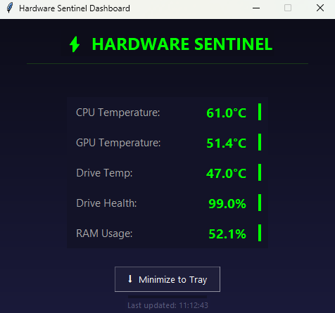

# Intelligent Hardware Sentinel (IHS)

A rule-based hardware monitor for Windows laptops, written in Python. It watches five channels (CPU temperature, GPU temperature, SSD temperature, SSD health and RAM utilisation), shows Windows toast notifications for three of them, and writes a one-row-per-cycle telemetry log that a separate script can audit against the alert rules.



It is a final-year Systems Engineering capstone project (University of Lagos). It is "intelligent" only in a narrow sense: its alert logic is rule-based, keeps state per channel and severity, and does not learn or predict. SSD health is the life-remaining figure the drive reports through SMART, not a validated predictor of drive failure.

## What it monitors

| Channel | Source | Alerts |
|---|---|---|
| CPU temperature | LibreHardwareMonitor, CPU Package sensor (WMI ACPI thermal zone as fallback, labelled as not the CPU die) | Warning at 80 C or more, critical at 90 C or more |
| GPU temperature | LibreHardwareMonitor (on the test laptop, the GPU Memory Junction sensor); NVML die temperature as fallback | None (display and log only) |
| SSD temperature | LibreHardwareMonitor, hottest non-threshold sensor per drive | None (display and log only) |
| SSD health | LibreHardwareMonitor Level sensor named life, drive rating, health or remaining; the lowest drive is used | Critical below 20% |
| RAM utilisation | `psutil.virtual_memory().percent` | Warning above 90% |

Drives are identified by model, because the library does not return drive letters. A reading that is missing (`None`, or 0 for a temperature) never raises an alert, never counts as normal and never resets a cooldown. A drive with no life sensor shows as unknown, not as 0%.

## Alert rules (Section 3.5.4 of the report)

- The first breach on a channel produces a toast at once.
- A breach at a more severe level than any that has notified (escalation) produces a toast at once.
- The cooldown is 60 seconds, kept per channel and per severity. A repeat inside it is withheld and logged. A toast at one severity also covers every lower severity.
- A drop to a lower severity is logged, with no toast.
- After three consecutive normal readings the episode ends (recovery). The cooldown timers are kept, so a renewed breach inside the cooldown is withheld, while a breach at a severity that has not notified is notified at once.

## Repository layout

| Path | Contents |
|---|---|
| `Codes/nvml-build/` | The final build: source, tests, tools, the build hashes and the evidence folder. Run and test from here |
| `Codes/nvml-build/evidence/Analysis_report/` | Analysis reports and the raw files of the retest runs (see "Evidence" below) |
| `Codes/soak_build/` | The build used for the long recordings of 3 to 6 November (before the recovery change), with its hash file `soak_version_hashes.txt` |
| `dashboard.png` | Screenshot of the dashboard |

## Requirements

- Windows, with administrator rights (the program offers to relaunch itself as administrator).
- Python 3.11.0. Install the packages with `pip install -r requirements.txt`.
- `LibreHardwareMonitorLib.dll` 0.9.6.0 and its companion DLLs (`HidSharp.dll`, `System.Memory.dll`, `RAMSPDToolkit-NDD.dll`, `System.Runtime.CompilerServices.Unsafe.dll`, `System.Numerics.Vectors.dll`, `DiskInfoToolkit.dll`, `BlackSharp.Core.dll`) are included in `Codes/nvml-build/`, next to `main.py`. They are third-party files from [LibreHardwareMonitor](https://github.com/LibreHardwareMonitor/LibreHardwareMonitor) (MPL-2.0); the licence text is in `LICENSE-LibreHardwareMonitor.txt`. Their SHA-256 values are in `build_hashes_final.txt`. If you download the repository as a ZIP, Windows may block the DLLs: right-click each file, choose Properties and tick Unblock.
- Tested on one machine: MSI MS-17E9 (Intel Core i7-10750H, NVIDIA GeForce RTX 2080 Super, two WDC PC SN730 NVMe drives, 15.8 GB RAM), Windows build 10.0.26200. The NVML GPU fallback has not been tested on any other machine.
- If the program crashes on launch, install the [Microsoft Visual C++ Redistributable (x64)](https://aka.ms/vs/17/release/vc_redist.x64.exe) and try again.

## Running it

```
cd Codes\nvml-build
python main.py                 # monitor in the background, toasts and telemetry
python main.py --dashboard     # the same, with the desktop dashboard
```

`Launch_Dashboard.vbs` starts the dashboard without a console window. `Intelligent_Hardware_Sentinel.exe` is a convenience build published on the Releases page ([PENDING: link, commit and SHA-256 after the rebuild]); the report evaluates the Python source above, not the `.exe`. See "Building the .exe" below.

## Building the .exe

```
pip install pyinstaller
cd Codes\nvml-build
pyinstaller Intelligent_Hardware_Sentinel.spec
Get-FileHash dist\Intelligent_Hardware_Sentinel.exe
```

This makes one file, `dist\Intelligent_Hardware_Sentinel.exe`, which asks for administrator rights when it starts. `Decepticons.ico` and all the DLLs listed under Requirements must be in the folder. `config.py` is bundled inside the `.exe`, so the thresholds in it cannot be changed without rebuilding. [PENDING: the PyInstaller version used.]

## Configuration (`config.py`)

| Setting | Value | Meaning |
|---|---|---|
| `CPU_TEMP_WARN`, `CPU_TEMP_CRITICAL` | 80, 90 | CPU thresholds in C (warning at or above) |
| `RAM_PERCENT_LIMIT` | 90 | RAM warning above this percentage |
| `SSD_HEALTH_CRITICAL` | 20 | Critical when life remaining is below this percentage |
| `SCAN_INTERVAL` | 2 | Seconds between cycles (the effective period is longer, about 2.2 to 2.5 s) |
| `LOG_TELEMETRY`, `TELEMETRY_FILE` | True, `sentinel_telemetry.csv` | Telemetry log on or off, and its file |
| `DEBUG_SENSORS` | False | When True, every cycle writes sensor enumeration to `sentinel_debug.log` (the log reached 51 MB) and slows the loop |
| `GPU_FORCE_NVML` | False | True forces the NVML GPU reading, to validate the fallback |

`DISK_PERCENT_LIMIT`, `CHECK_NETWORK` and `CHECK_SSD_HEALTH` are declared but not used by the monitoring loop. Network monitoring is out of scope.

## Files

| File | Purpose |
|---|---|
| `main.py` | Polling loop, alert checks (`check_alerts`), telemetry writing |
| `sensors.py` | Reads the sensors through LibreHardwareMonitor, with the WMI and NVML fallbacks |
| `gpu_nvml.py` | NVML GPU temperature reader |
| `alerts.py` | Rate-limited alert delivery (the rules above) |
| `telemetry_log.py` | One CSV row per cycle |
| `dashboard.py` | Desktop dashboard (green, amber and red follow the alert thresholds for CPU temperature, RAM and SSD life; GPU and SSD temperature show amber at 80 and 70 C) |
| `analyze_telemetry.py` | Audits a telemetry file against the alert rules |
| `induce_breach.py`, `config_shifted_test.py`, `load_cycle.py` | Tools that provoke breaches and load for testing |
| `compare_gpu_sources.py` | Compares the LibreHardwareMonitor and NVML GPU readings |
| `measure_overhead.py` | Measures Sentinel's CPU and memory use (run from a scratch copy of the folder) |
| `test_*.py` | Unit tests (123 in total) |

## Telemetry file

Columns: `timestamp, loop, cpu_temp, gpu_temp, ssd_temp, ssd_health, ram_percent, alert_events, alert_ms, ssd_detail`.
`alert_events` holds `channel:severity:outcome` entries (outcome is `sent`, `suppressed`, `deescalated` or `failed`) and `channel:recovered`. `ssd_detail` lists health and temperature per drive. `alert_ms` is the time the alert check took in that cycle, including toast display.

## Tests

```
python -m unittest
```

Expected: `Ran 123 tests ... OK`. No administrator rights, sensors or toast support are needed; the tests replace them. `test_check_alerts.py` and `test_dashboard_indicator.py` import `main.py` with the administrator relaunch switched off. `test_dashboard_indicator.py` also needs `tkinter`, Pillow and `pystray` (it is skipped if they are missing); it compares the dashboard colours with the states the alert logic assigns to the same readings (0 disagreements on 416 readings).

## Auditing a recording

```
python analyze_telemetry.py <telemetry.csv> --config config.py --out <report folder>
```

It writes `analysis_report.md` and `analysis_mismatches.csv`. The audit replays the alert rules over the readings the tool itself logged, so it checks the alert logic against its written rules; it does not check sensor accuracy. Use the analyzer version that matches the recording:

| Recording | Dates | `DEBUG_SENSORS` | Analyzer | Expected result |
|---|---|---|---|---|
| Early recording | 1 to 2 Nov 2026 | True | either version | CPU 3 of 3, RAM 4 of 4 |
| Long recordings (5 sessions, 24,370 cycles) | 3 to 6 Nov | True | soak-build version (SHA-256 starts 118A5095) | CPU 197 of 197, RAM 43 of 43 |
| Loaded run (2,632 cycles) | 8 Nov | False | final version (starts E047C2BB) | CPU 70 of 70, RAM 6 of 6 |
| Game run (1,722 cycles) | 8 Nov | False | final version | CPU 20 of 20, RAM 13 of 13 |
| Hard Disk Sentinel comparison (524 cycles) | 11 Nov | False | not alert-related | Health equal on both drives, temperatures equal at the program's refresh times |

The long recordings were made before the recovery change, so the final analyzer correctly flags the toasts the earlier code sent for renewed breaches. Do not use it on them.

## Evidence

All under `Codes/nvml-build/evidence/Analysis_report/`:

| Folder or file | Contents |
|---|---|
| `run_loaded/` | Analysis report, mismatch list, raw telemetry CSV and log of the loaded run (8 Nov) |
| `run_game/` | Analysis report, mismatch list and raw telemetry CSV of the game run (8 Nov) |
| `run_long/` | Analysis report and mismatch list of the long recordings (3 to 6 Nov) |
| `run_shifted_thresholds/` | Analysis report and mismatch list of the threshold-shifted CPU test (a logic test, not proof that the real threshold is reached) |
| `load_phases.log` | Phase times of the loaded run |
| `Battery_report.webp` | Windows battery report |
| `Hard Disk_comparison/` | Hard Disk Sentinel screenshots of 11 Nov, used to check drive health and temperature |

[PENDING: the raw telemetry files of the long recordings, the shifted-threshold run and the early recording are not in this folder. Add them, or state where they are kept.]

## Build record

- Final build: the commit tagged `final-build`. It holds every file in `Codes/nvml-build`, including all 22 source and test files (123 tests pass) and the DLLs. Earlier commits did not hold the complete set, so cite the tag, not an earlier commit. Commit `90a30bd904284c328d5f3ff51a20373f6387c46a` added the dashboard aligned with the alert thresholds and its test to commit `2ea988eaebf52b495688fefcd2dc24c0ae7c333f`.
- Recovery change: commit `5544d8237862f19ca2a8652c5b9f0b40631751af` (tag `t8-build`).
- SHA-256 of every source file: `Codes/nvml-build/build_hashes_final.txt`. The soak-build hashes (6 November) are in `Codes/soak_build/soak_version_hashes.txt`.
- The long recordings ran with `DEBUG_SENSORS = True`. The earlier `config.py` snapshot committed on 6 November has that setting; the current one has False.

## Known limitations

- One laptop, one workload family, short runs for the overhead measurement (about 0.8 to 0.9% of one core and 95 MB for the Sentinel process).
- No overnight run was possible because of an unstable power supply; the longest session was 6.3 hours.
- SSD life alerts were tested by injected values only, because neither drive has breached.
- GPU and SSD temperatures are displayed and logged but never alert. On the test laptop the GPU reading is the memory junction temperature, about 6 C above the die temperature NVML reports.
- A drive whose firmware reports 0% life as a placeholder would be treated as worn out.

## Built with

- Python
- [LibreHardwareMonitor](https://github.com/LibreHardwareMonitor/LibreHardwareMonitor)

## Author

Osiughwu Enoho, Department of Systems Engineering, University of Lagos.
