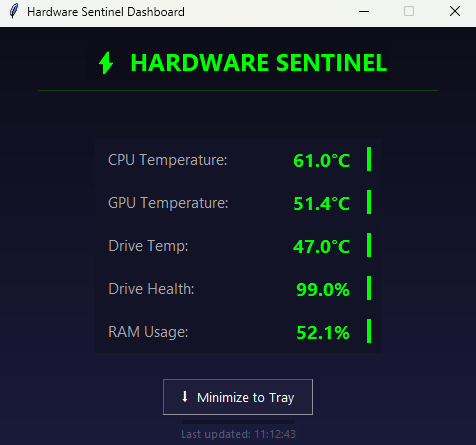

# Intelligent Hardware Sentinel (IHS)

A Windows hardware monitoring application written in Python. It watches your system's temperatures, drive health and memory use, shows them on a live dashboard, and raises desktop alerts when something needs attention.

## Features

- **Live dashboard** showing CPU temperature, GPU temperature, drive temperature, drive health and RAM usage, with a "last updated" timestamp.
- **Desktop toast alerts** when readings cross warning levels. Alerts fire whether or not the dashboard is open.
- **Alert cooldown (rate limiting)** so the same condition does not flood you with repeated notifications.
- **Logging** of readings and events, so long monitoring sessions can be reviewed and analysed afterwards.
- **Minimize to tray** so the sentinel keeps running quietly in the background.
- Sensor data is read through [LibreHardwareMonitor](https://github.com/LibreHardwareMonitor/LibreHardwareMonitor).

## Requirements

- Windows 10 or 11 (Windows only)
- Administrator access (needed to read hardware sensors)
- [Microsoft Visual C++ Redistributable (x64)](https://aka.ms/vs/17/release/vc_redist.x64.exe)

## Quick start

1. Download the zip from Releases.
2. extract it, and double-click `Launch_Dashboard.vbs` to open the dashboard.
3. Click **Yes** when Windows asks for administrator permission.

If the application crashes on launch, install the Visual C++ Redistributable linked above and try again.

## Project layout

| Path | Purpose |
| --- | --- |
| `Codes/` | Python source code |
| `Intelligent_Hardware_Sentinel.exe` | Packaged application |
| `Launch_Dashboard.vbs` | Starts the sentinel with the dashboard |

## Known limitations

- Some laptops (observed on a Dell machine) do not expose GPU temperature through WMI or LibreHardwareMonitor. The WMI recovery fallback currently covers the CPU only, so GPU temperature may show as unavailable on those systems.
- An NVIDIA-specific fallback using NVML is being considered to address the GPU case.

## Built with

- Python
- LibreHardwareMonitor
